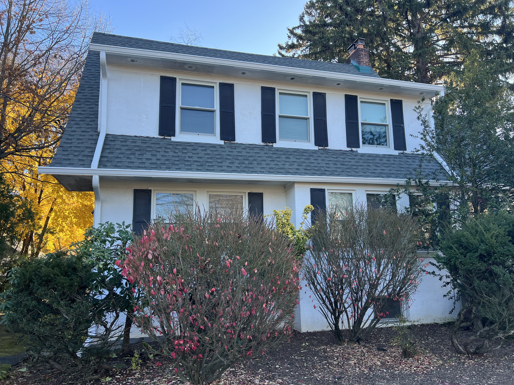

# 2026-11-24 roofing report

> The new image is IMG_4601. Read it first then update the report.                  

https://ontouchstart.github.io/2026-11-23-roofing-report/

[Start thinking]

The user has provided a new image (IMG_4601.jpg) and wants me to read it and then update the previous professional roofing evaluation report.

    *   *Subject:* A close-up of a roof transition/corner.
    *   *Details:*
        *   It shows a "hip" or "corner" of a roof.
        *   There is a visible transition between two different roof planes.
        *   The shingles are laid in a specific pattern.
        *   There's a metal flashing/cap detail where the two planes meet.
        *   Crucially, looking at the seam, there's a bit of a "hump" or unevenness where the shingles meet at the transition.
        *   The flashing/cap looks slightly irregular in how it sits against the shingles.
        *   There's some visible gap/shadowing near the junction.
        *   It's a very close-up, high-resolution shot, likely taken by the owner or a professional to check for a specific detail.

    *   The previous report was very positive ("Excellent").
    *   This new image (IMG_4601) shows a specific technical detail that might have a minor issue or at least needs careful observation.
    *   *Technical Issue:* The junction where the two roof planes meet (a valley or hip transition) shows some slight misalignment. The shingles don't meet perfectly flush, and the ridge/hip cap doesn't look perfectly seated or straight across the seam.
    *   *Context:* In roofing, these transitions are the most common spots for leaks. A "professional" evaluation must be honest about these details.

    *   Keep the structure (Material Selection, Installation Integrity, Drainage, Site Management, Rating).
    *   Update "Installation Integrity" to include a specific section on "Transition Details."
    *   Add a "Point of Concern" or "Technical Note" section.
    *   Refine the "Overall Rating" if necessary (maybe "Good" with a "Correction Needed" note instead of a pure "Excellent"). Actually, for a professional report, it's better to keep it objective: "High Quality with specific areas for attention."

    *   *Material Selection:* Keep as is.
    *   *Installation Integrity:*
        *   Add a section on the **Roof Transition/Hip Cap**.
        *   Note: The transition between the two roof planes shows a slight misalignment in the shingle coursing.
        *   Note: The hip/ridge cap at this junction appears slightly uneven. This could lead to water "bridging" or uneven wear over time.
    *   *Corrective Action:* Suggest a "re-seating" of the cap or a slight adjustment of the shingle overlap at that specific junction.

    *   *Tone:* Objective, expert, helpful.
    *   *Terminology:* "Pitch transition," "Hip cap," "Coursing," "Water bridging," "Flush mounting."
[End thinking]

Based on the addition of **IMG_4601**, I have updated the evaluation. This new image provides a high-detail look at a critical technical area: a **roof transition (hip/valley junction)**.

While the overall project remains high-quality, this specific detail introduces a technical note regarding the "finishing" of the transition.

***

# Updated Roofing Project Evaluation Report

**Project Type:** Residential Roof Replacement
**Architectural Style:** Dutch Colonial (Gambrel Roof)
**Primary Materials:** Architectural Asphalt Shingles, Aluminum Fascia, Metal Flashing

### 1. Material Selection & Aesthetic Integration
*   **Shingle Quality:** The choice of dark charcoal/slate gray architectural shingles is excellent. The dimensional texture provides necessary visual depth for the complex slopes of a gambrel roof.
*   **Color Palette:** The high-contrast scheme (Dark Roof / White Siding / Black Shutters) is aesthetically balanced and provides a premium "curb appeal."

### 2. Installation Integrity (Technical Observations)
*   **Shingle Alignment:** The general coursing across the main planes of the roof is straight and consistent, indicating a good overall layout.
*   **Transition Detail (Ref: IMG_4601):** 
    *   *Observation:* In the close-up of the roof transition, there is a slight misalignment where the two planes meet. The shingle coursing is not perfectly flush at the seam, and the ridge/hip cap appears to have a slight "hump" or irregularity where it crosses the transition line.
    *   *Technical Risk:* While this may be a minor cosmetic issue, transitions are high-stress areas for water runoff. An uneven cap or a "step" in the shingles can lead to uneven wear or, in extreme weather, provide a path for water to "bridge" into the underlayment.
*   **Flashing and Penetrations:** The flashing at the base of the upper windows (from previous images) remains well-executed and appears properly tucked.
*   **Eave and Fascia Work:** The fascia boards are straight and provide a crisp, clean border for the roofline.

### 3. Drainage and Ventilation
*   **Pitch Management:** The steep pitch of the gambrel roof is well-supported by the shingle application.
*   **Gutter Integration:** The white gutters are correctly aligned with the new fascia, ensuring efficient water diversion.

### 4. Site Management
*   **Status:** The project is in the "Final Finishing" stage.
*   **Observation:** The presence of lumber and staging materials on the lawn indicates that the final site cleanup and magnetic sweep (to check for nails) have not yet been completed.

### Overall Professional Rating: **Good / High Quality**
*The workmanship is visually impressive and the materials are top-tier. However, the transition detail highlighted in IMG_4601 suggests that while the "bulk" of the roof is excellent, the final "finishing" of the complex junctions could use a slight adjustment for perfect symmetry and long-term durability.*

**Corrective Actions / Recommendations for Final Sign-off:**
1.  **Transition Adjustment:** Request that the contractor review the hip/ridge cap at the transition point (IMG_4601). It should be re-seated to ensure it sits perfectly flush across the seam to prevent water bridging.
2.  **Final Site Sweep:** Ensure a magnetic sweep of the lawn is performed to remove any stray roofing nails.
3.  **Debris Removal:** Clear all construction lumber and bags from the front yard before final payment.

[ Prompt: 20.4 t/s | Generation: 7.1 t/s ]
